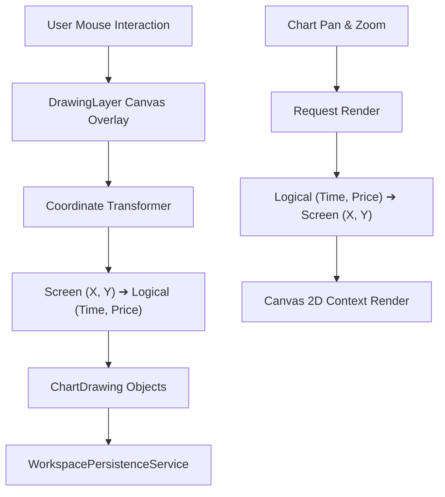

# Interactive Vector Drawing System

## Overview

Unlike standard dashboard charting components, TradingView-grade charting requires an interactive vector drawing system that anchors annotations directly to logical price levels and timestamps rather than static screen pixels.

## Supported Drawing Primitives

1. **Trendline**: 2-point line segment with customizable line width, style, and color.
2. **Horizontal Line**: 1-point price level line extending indefinitely across the entire canvas.
3. **Vertical Line**: 1-point timestamp marker extending across the full height of the chart.
4. **Fibonacci Retracement**: 2-point reference line generating canonical retracement levels (0.0%, 23.6%, 38.2%, 50.0%, 61.8%, 78.6%, 100.0%) with distinct color bands.
5. **Rectangle Zone**: 2-point bounding box for supply/demand zones with semi-transparent frosted fills.
6. **Risk/Reward Box**: Visual long/short setup planning displaying stop distance, profit target, and ratio.

## Selection & Handle Mechanics

- Hover hit-testing detects cursor proximity within 10px of drawing anchors.
- Click selects a drawing, rendering active white anchor circular handles with blue halos.
- Dragging any handle updates the logical coordinates and dispatches `drawingUpdated`.
- Pressing `Delete` or `Backspace` purges the selected drawing and triggers persistent storage sync.
