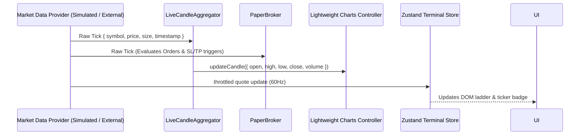

# Market Data Pipeline & Architecture

## Overview

The terminal utilizes a decoupled, provider-agnostic data pipeline designed to ingest, normalize, and stream market events with sub-millisecond dispatch overhead.

## Key Components

1. **`IMarketDataProvider`**:
   Standardized interface exposing:
   - `getInstruments(): Promise<Instrument[]>`
   - `getHistoricalCandles(symbol, timeframe, limit): Promise<Candle[]>`
   - `subscribeTicks(symbol, onTick): () => void`
   - `subscribeOrderBook(symbol, onBook): () => void`
   - `subscribeTrades(symbol, onTrade): () => void`

2. **High-Fidelity Simulation Provider (`SimulatedMarketDataProvider`)**:
   - Generates realistic geometric Brownian motion with trend shocks and volatility bursts.
   - Computes realistic Level 2 bid/ask ladders (10 levels deep) with dynamically replenished volume.
   - Emits real-time trade tape events with buy/sell aggressive aggressor flags.

3. **Incremental Candle Aggregation (`LiveCandleAggregator`)**:
   - Aggregates sub-second ticks into time buckets (`1s`, `1m`, `5m`, `15m`, `1h`, `4h`, `1D`).
   - Detects bar boundaries and emits `isNewCandle` signals to the chart controller without re-rendering historical candles.
