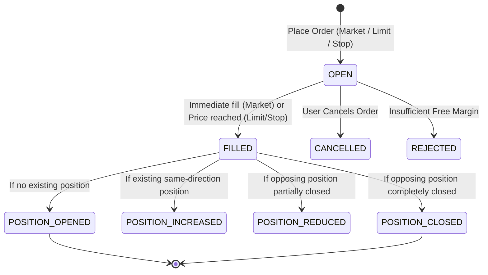

# Paper Trading Execution & Risk Engine

## Architecture

The Paper Trading Engine simulates an institutional broker environment with deterministic execution semantics, realistic fee modeling, and position lifecycle management.

## Order Types & Matching Rules

1. **Market Orders**:
   - Matches immediately at the current ask (for Buy) or bid (for Sell).
   - Accounts for slippage and commission fees (default: 0.05%).

2. **Limit Orders**:
   - Buy Limit: Enters resting book; fills when market price $\le$ `limitPrice`.
   - Sell Limit: Enters resting book; fills when market price $\ge$ `limitPrice`.

3. **Stop Orders & Brackets**:
   - Buy Stop: Triggers market buy when market price $\ge$ `stopPrice`.
   - Sell Stop: Triggers market sell when market price $\le$ `stopPrice`.
   - Take Profit & Stop Loss brackets are monitored tick-by-tick to protect capital automatically.

## P&L Valuation Formulas

- **Long Unrealized P&L**:
  $$\text{Unrealized P&L}_{\text{Long}} = (\text{Current Price} - \text{Entry Price}) \times \text{Quantity}$$

- **Short Unrealized P&L**:
  $$\text{Unrealized P&L}_{\text{Short}} = (\text{Entry Price} - \text{Current Price}) \times \text{Quantity}$$

- **Account Equity**:
  $$\text{Equity} = \text{Cash} + \sum \text{Unrealized P&L}$$
