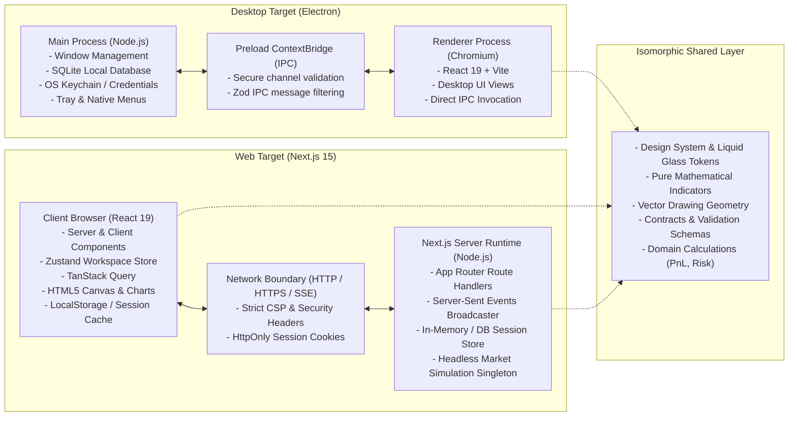
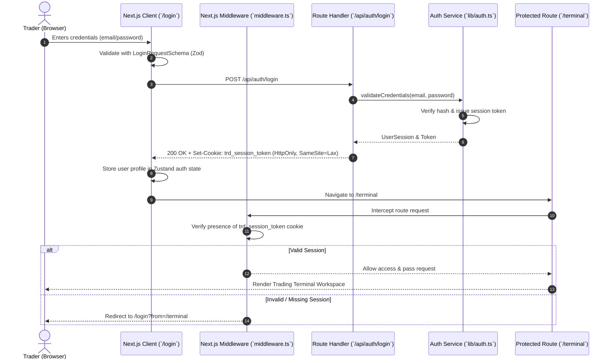
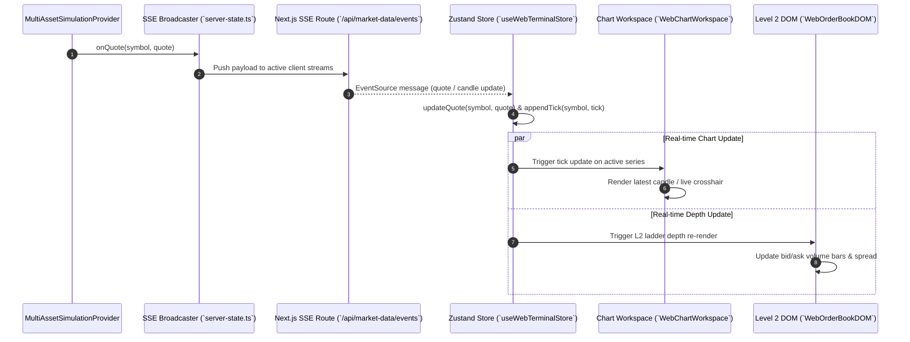
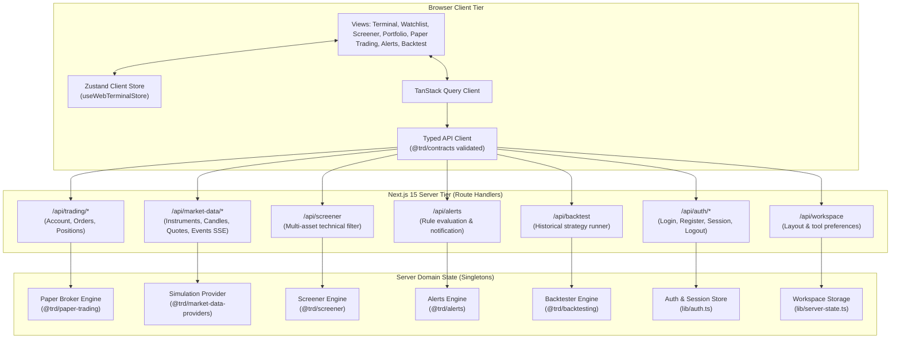
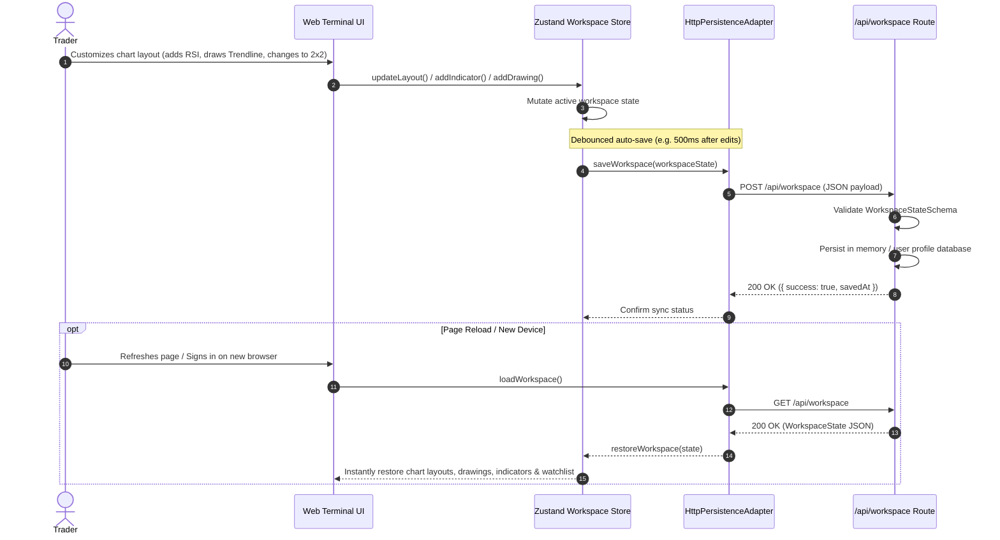
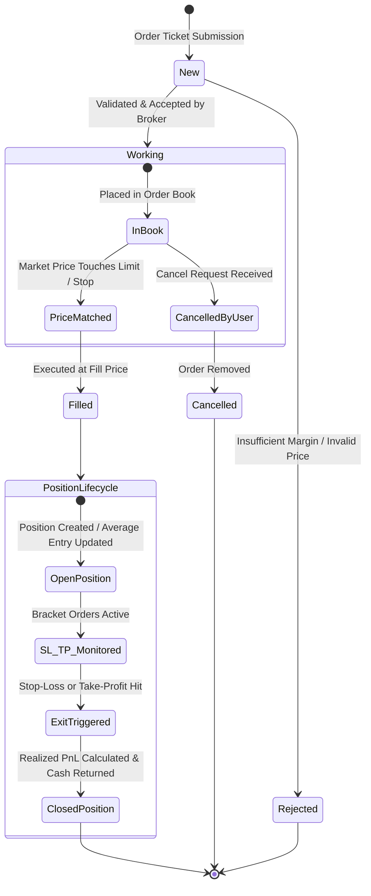

# TRD Pro — Web Application Architecture & Cross-Platform Specification

This document provides a comprehensive architectural specification of the **TRD Pro Next.js Web Application** (`apps/web`) and its integration within the cross-platform monorepo alongside the Electron desktop application (`apps/desktop`).

---

## 1. Monorepo Architecture Overview

The TRD Pro platform is structured as a high-cohesion `pnpm` monorepo dividing platform-specific application shells from reusable domain, UI, and market-data packages.

```mermaid
flowchart TD
    subgraph Applications["Applications (apps/)"]
        Desktop["apps/desktop\n(Electron Desktop Shell)"]
        Web["apps/web\n(Next.js 15 App Router)"]
    end

    subgraph SharedPackages["Shared Packages (packages/)"]
        subgraph ContractsConfig["Contracts & Configuration"]
            Contracts["@trd/contracts\n(Zod Schemas, DTOs, TypeScript Types)"]
            Config["@trd/configuration\n(Symbols, Timeframes, Constants)"]
            Logging["@trd/logging\n(Structured Logger)"]
        end

        subgraph CoreMath["Core Domain & Calculations"]
            Domain["@trd/domain\n(PnL, Position Sizing, Margins)"]
            SharedUtils["@trd/shared-utils\n(Formatters, Math, EventEmitter, IDs)"]
            Indicators["@trd/indicators\n(SMA, EMA, RSI, MACD, BB, Supertrend)"]
        end

        subgraph UIDesign["UI & Design System"]
            DesignSystem["@trd/design-system\n(Liquid Glass Tokens, Themes, Colors)"]
            UI["@trd/ui\n(GlassPanel, GlassButton, Tabs, Badges)"]
        end

        subgraph Charting["Charting Engine"]
            ChartCore["@trd/chart-core\n(Lightweight Charts Adapter, Series)"]
            ChartDrawings["@trd/chart-drawings\n(Vector Drawing Overlay, Trendlines, Fib)"]
        end

        subgraph MarketData["Market Data Pipeline"]
            MarketDataPkg["@trd/market-data\n(Provider Interfaces, Candle Aggregation)"]
            MarketDataProviders["@trd/market-data-providers\n(Multi-Asset Simulation Engine)"]
        end

        subgraph TradingAnalytics["Trading Engines & Analytics"]
            TradingEngine["@trd/trading-engine\n(Order State Machine, Interfaces)"]
            PaperTrading["@trd/paper-trading\n(Paper Broker, Position Tracker)"]
            RiskEngine["@trd/risk-engine\n(Portfolio Risk, Exposure Evaluator)"]
            Portfolio["@trd/portfolio\n(Equity Curves, Win Rate, Allocation)"]
            Screener["@trd/screener\n(Multi-Condition Filtering Engine)"]
            Alerts["@trd/alerts\n(Price Threshold & Trigger Evaluator)"]
            Backtesting["@trd/backtesting\n(Historical Strategy Simulator)"]
        end

        subgraph Storage["Persistence"]
            Persistence["@trd/persistence\n(LocalStorage, HTTP, Memory Adapters)"]
        end
    end

    Desktop --> UI
    Desktop --> DesignSystem
    Desktop --> ChartCore
    Desktop --> ChartDrawings
    Desktop --> Indicators
    Desktop --> MarketDataProviders
    Desktop --> PaperTrading
    Desktop --> Persistence

    Web --> UI
    Web --> DesignSystem
    Web --> ChartCore
    Web --> ChartDrawings
    Web --> Indicators
    Web --> MarketDataProviders
    Web --> PaperTrading
    Web --> RiskEngine
    Web --> Portfolio
    Web --> Screener
    Web --> Alerts
    Web --> Backtesting
    Web --> Persistence
    Web --> Contracts
    Web --> Config
```



---

## 2. Shared Packages & Dependency Graph

All shared packages are pure isomorphic TypeScript packages with standard ESM exports, allowing direct compilation by both Vite (in Electron) and Next.js / Webpack / Turbopack (in Web).

```mermaid
flowchart TD
    Contracts["@trd/contracts"]
    Config["@trd/configuration"]
    SharedUtils["@trd/shared-utils"]
    Logging["@trd/logging"]

    Domain["@trd/domain"] --> Contracts
    Domain --> SharedUtils

    DesignSystem["@trd/design-system"]
    UI["@trd/ui"] --> DesignSystem

    Indicators["@trd/indicators"] --> Contracts
    Indicators --> SharedUtils

    ChartDrawings["@trd/chart-drawings"] --> Contracts
    ChartCore["@trd/chart-core"] --> Contracts
    ChartCore --> Indicators

    MarketData["@trd/market-data"] --> Contracts
    MarketDataProviders["@trd/market-data-providers"] --> MarketData
    MarketDataProviders --> SharedUtils

    TradingEngine["@trd/trading-engine"] --> Contracts
    PaperTrading["@trd/paper-trading"] --> TradingEngine
    PaperTrading --> Domain

    RiskEngine["@trd/risk-engine"] --> Domain
    Portfolio["@trd/portfolio"] --> Domain
    Screener["@trd/screener"] --> Contracts
    Alerts["@trd/alerts"] --> Contracts
    Backtesting["@trd/backtesting"] --> Contracts
    Backtesting --> Indicators

    Persistence["@trd/persistence"] --> Contracts
```



---

## 3. Electron vs. Next.js Runtime Boundaries

The application cleanly separates desktop-native system capabilities from web and browser runtimes. No Electron main-process or Node-only OS bindings are bundled into the web client.



---

## 4. Browser Authentication & Session Flow

Authentication on the web application follows a secure cookie-based session pattern using HTTP-only cookies and Next.js middleware protection.



---

## 5. Market-Data Streaming Pipeline (SSE)

Market data feeds into the web application via Server-Sent Events (SSE), providing real-time quote updates, candle bars, and order book depth without client-side Node dependencies.



---

## 6. Client, Next.js Server & Backend API Interactions

The application leverages Next.js Route Handlers to isolate business engines, market simulation state, and data management on the server tier.



---

## 7. Workspace Persistence & Synchronization

Workspaces are preserved across browser refreshes and sync transparently between client storage and the server persistence store.



---

## 8. Paper-Trading Order Lifecycle

The paper trading execution engine handles market, limit, stop, and bracket (SL/TP) orders with realistic balance and margin accounting.



---

## 9. Developer Setup & Operations

### Prerequisites
- **Node.js**: v20.x or v22.x+
- **pnpm**: v10.x+ (`corepack enable pnpm`)
- Modern web browser (Chrome, Safari, Firefox, Edge)

### Installation
```bash
# Clone the repository and install all workspace dependencies
git clone <repo-url>
cd trd-ele
pnpm install
```

### Running Locally
```bash
# Start Next.js web application (http://localhost:3000)
pnpm dev:web

# Start Electron desktop application
pnpm dev:desktop

# Run both desktop and web concurrently
pnpm dev
```

### Verification & Testing
```bash
# Run all unit and integration tests across all 20 packages and apps/web
pnpm test

# Run end-to-end integration tests
pnpm test:e2e

# Run strict TypeScript typecheck across all monorepo workspaces
pnpm typecheck

# Run linter
pnpm lint

# Build all packages and applications for production
pnpm build
```

---

## 10. Data Provider Configuration

The web application ships with a deterministic, multi-asset market simulation provider (`MultiAssetSimulationProvider`) that models realistic market micro-structure (spreads, ticks, order books, volatility).

To switch to a live market data provider (e.g. Binance, Coinbase, Polygon, Interactive Brokers):
1. Implement the `MarketDataProvider` interface defined in `@trd/market-data`.
2. Configure provider API credentials in `.env.local`:
   ```bash
   MARKET_DATA_PROVIDER=live
   MARKET_DATA_API_KEY=your_secure_server_key
   MARKET_DATA_WS_URL=wss://feed.yourprovider.com/stream
   ```
3. Initialize the provider in `apps/web/src/lib/server-state.ts`.
4. *Important Security Rule*: Never prefix backend market provider API keys or secrets with `NEXT_PUBLIC_`.

---

## 11. Authentication Configuration

The web application includes an authentication system with a preconfigured demo account:
- **Email**: `demo@trdpro.io`
- **Password**: `demo123`

### Production Auth Setup
To integrate with an identity provider (Auth0, Supabase, Clerk, AWS Cognito, NextAuth):
1. In `apps/web/src/lib/auth.ts`, replace the in-memory user registry with your database or auth provider client.
2. Maintain the contract interface (`validateCredentials`, `createSession`, `getSessionUser`) defined in `@trd/contracts`.
3. Set the cookie encryption secret in `.env.production`:
   ```bash
   AUTH_SECRET=super_secret_64_char_key
   COOKIE_DOMAIN=.yourdomain.com
   ```

---

## 12. Production Deployment Guidelines

### Standalone Docker Deployment
`apps/web` can be deployed as a containerized standalone Next.js server:
```dockerfile
FROM node:20-alpine AS builder
WORKDIR /app
RUN corepack enable pnpm
COPY . .
RUN pnpm install --frozen-lockfile
RUN pnpm build:web

FROM node:20-alpine AS runner
WORKDIR /app
ENV NODE_ENV=production
COPY --from=builder /app/apps/web/.next/standalone ./
COPY --from=builder /app/apps/web/.next/static ./apps/web/.next/static
COPY --from=builder /app/apps/web/public ./apps/web/public
EXPOSE 3000
CMD ["node", "apps/web/server.js"]
```

### Vercel / Cloudflare Deployment
Configure build settings in the deployment dashboard:
- **Root Directory**: `apps/web` (or root with `--filter @trd/web`)
- **Build Command**: `pnpm build:web`
- **Output Directory**: `.next`

---

## 13. Connection Troubleshooting

| Symptom | Probable Cause | Resolution |
| :--- | :--- | :--- |
| **SSE Market Feed Disconnected** | Browser firewall or reverse proxy buffering SSE chunks | Ensure Nginx / Cloudflare has buffering disabled: `proxy_buffering off;` and `X-Accel-Buffering: no`. |
| **Auth Session Lost on Refresh** | Cookie rejected due to `Secure` flag on HTTP localhost | In development, cookies set `secure: process.env.NODE_ENV === 'production'`. Ensure testing over HTTPS if configured for production. |
| **Hydration Mismatch on Chart** | DOM-dependent Canvas code executing during SSR | Charts are wrapped inside Client Components with `useEffect` and container ref checks to guarantee browser-only execution. |
| **Drawings Displaced on Resize** | Canvas pixel buffer not synced with CSS dimensions | Canvas resizing is handled via `ResizeObserver` updating width/height properties and re-rendering paths against logical prices. |

